# SIMAS — Sistem Informasi Manajemen Absensi Siswa

Aplikasi web untuk mengelola data akademik dan **absensi siswa** di sekolah menengah.
Dibangun dengan **Laravel 10 + Blade + Tailwind CSS + Alpine.js + Chart.js**, dengan
basis data MySQL/MariaDB.

Proyek ini dibuat sebagai portofolio full-stack: mencakup autentikasi berbasis role,
otorisasi di sisi server (policy + middleware), pencegahan duplikasi data di level
database, rekap laporan dengan ekspor CSV, dan dashboard yang seluruh angkanya
diambil dari query database (bukan angka statis).

> Seluruh data yang disertakan adalah **data demo yang di-generate otomatis**
> (seeder deterministik). Tidak ada data pribadi nyata.

---

## Daftar Isi

1. [Fitur Utama](#fitur-utama)
2. [Tangkapan Layar](#tangkapan-layar)
3. [Peran Pengguna](#peran-pengguna)
4. [Persyaratan Sistem](#persyaratan-sistem)
5. [Instalasi dari Awal](#instalasi-dari-awal)
6. [Akun Demo](#akun-demo)
7. [Aturan Bisnis Penting](#aturan-bisnis-penting)
8. [Menjalankan Test](#menjalankan-test)
9. [Struktur Proyek](#struktur-proyek)
10. [Troubleshooting](#troubleshooting)
11. [Keamanan & Privasi](#keamanan--privasi)

---

## Fitur Utama

### Autentikasi & Otorisasi
- Login menggunakan **email atau username**.
- Pembatasan percobaan login (5 kali per 60 detik) untuk mencegah brute force.
- Akun nonaktif ditolak saat login, dan dipaksa logout bila dinonaktifkan
  saat sesi masih berjalan.
- Otorisasi **di sisi server** (middleware role + policy), bukan sekadar
  menyembunyikan tombol di UI.

### Administrator
- CRUD **pengguna, guru, siswa, kelas, mata pelajaran, dan jadwal**.
- Pencegahan bentrok jadwal (guru dan kelas) saat menyimpan jadwal.
- Penghapusan data master diblokir bila masih memiliki riwayat terkait —
  sistem menyarankan menonaktifkan sebagai gantinya.
- **Admin utama dilindungi**: akun `admin@simas.test` tidak dapat dihapus
  maupun dinonaktifkan.
- Rekap absensi seluruh sekolah: filter kelas, mata pelajaran, status, dan
  rentang tanggal + **ekspor CSV**.
- **Audit log** aktivitas penting (pembuatan sesi absensi, koreksi, dsb).
- Dashboard dengan statistik nyata dari database dan grafik tren 14 hari.

### Guru
- Dashboard jadwal hari ini beserta status pengisian absensi.
- Jadwal mengajar mingguan (hanya jadwal miliknya sendiri).
- **Form absensi massal**: pilih status per siswa, tombol isi cepat, catatan
  per siswa, dan penghitung langsung.
- Tanpa status otomatis: setiap siswa harus dikonfirmasi kehadirannya.
- Sesi absensi dapat **dikoreksi dalam jendela 7 hari** (dapat diubah melalui
  `SIMAS_ATTENDANCE_EDIT_WINDOW_DAYS`). Di luar jendela itu, sesi hanya
  dapat dilihat.

### Siswa
- Dashboard pribadi dengan ringkasan status dan persentase kehadiran.
- Jadwal kelas.
- Riwayat absensi pribadi dengan filter bulan, status, dan mata pelajaran.
- Seluruh query dibatasi ke siswa yang sedang login — **tidak ada parameter URL**
  yang dapat dipakai untuk membuka data siswa lain.

### UI/UX
- Design system konsisten (palet hijau sage + aksen gold) dengan komponen
  Blade yang dapat digunakan ulang.
- **Mode gelap** yang tersimpan di `localStorage`.
- Responsif (desktop, tablet, ponsel) dengan sidebar/drawer.
- Halaman error kustom (403, 404, 419, 500), empty state, toast, dan
  dialog konfirmasi hapus.
- Aksesibilitas: navigasi keyboard, `aria-*`, `focus-visible`, dan dukungan
  `prefers-reduced-motion`.

---

## Tangkapan Layar

Seluruh tangkapan layar tersimpan di [`docs/screenshots/`](docs/screenshots) dan
dapat dibuat ulang dengan `node scripts/capture-screenshots.cjs`.

Skrip tersebut memerlukan Google Chrome/Edge yang sudah terpasang dan satu paket
opsional (tidak masuk `package.json` agar instalasi utama tetap ringan):

```bash
npm install --no-save puppeteer-core
php artisan serve        # di terminal lain
node scripts/capture-screenshots.cjs
```

Setel `CHROME_PATH` bila browser berada di lokasi berbeda, dan `SIMAS_URL` bila
aplikasi berjalan pada alamat lain.

### Halaman publik

| Landing | Login |
| --- | --- |
| 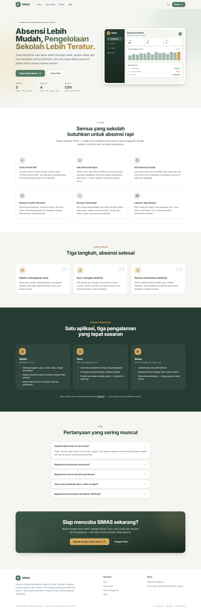 | 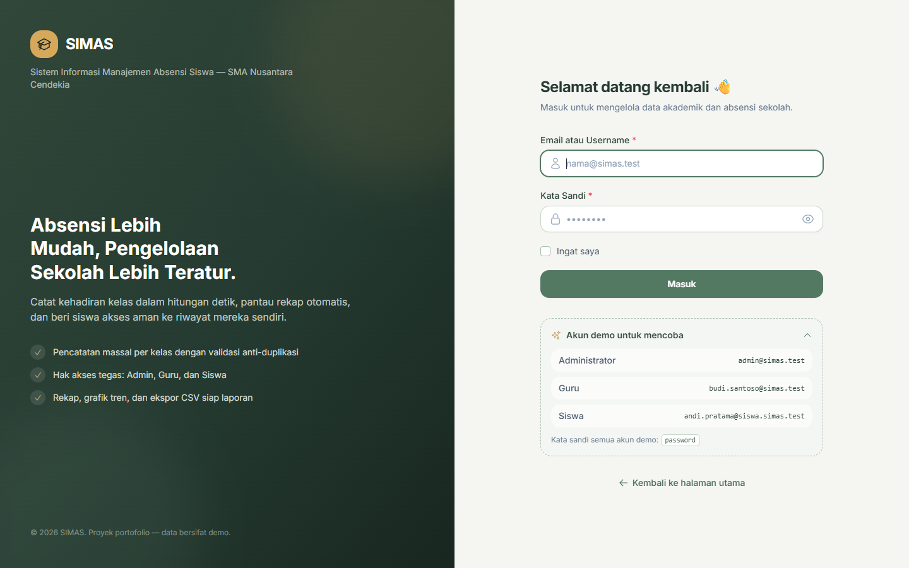 |

### Panel admin

| Dashboard | Rekap absensi |
| --- | --- |
| 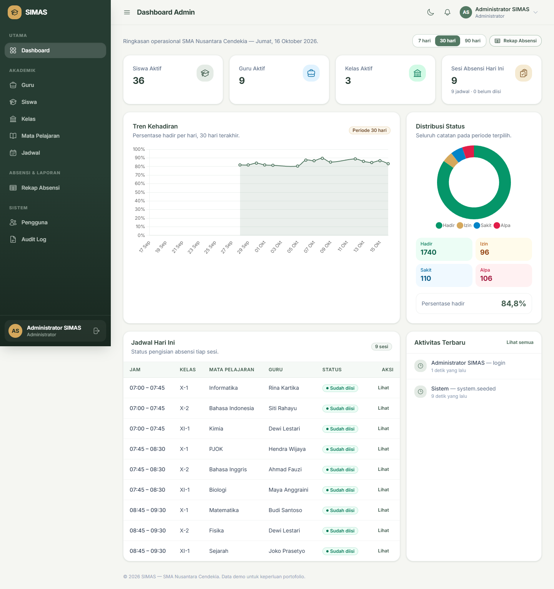 | 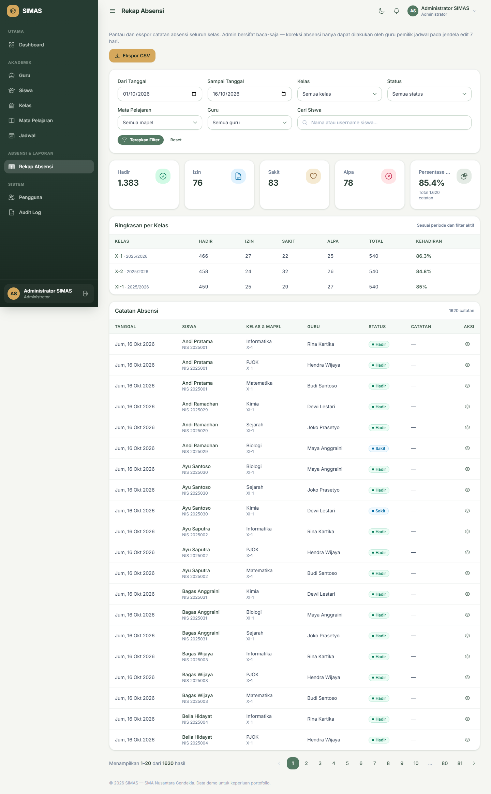 |

| Data siswa | Jadwal pelajaran |
| --- | --- |
| 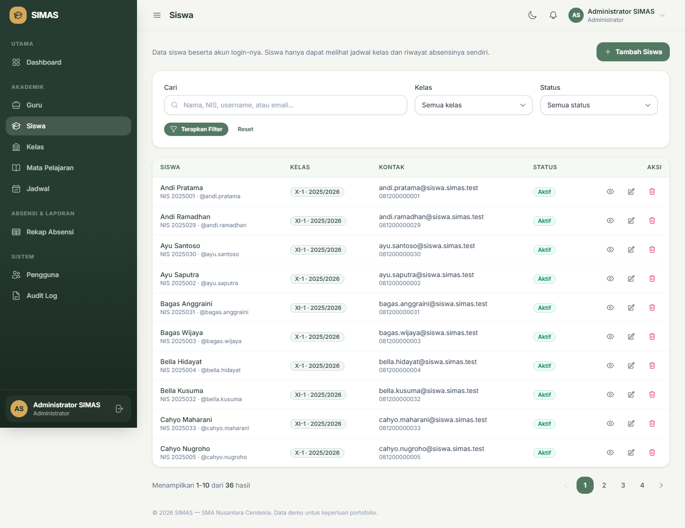 | 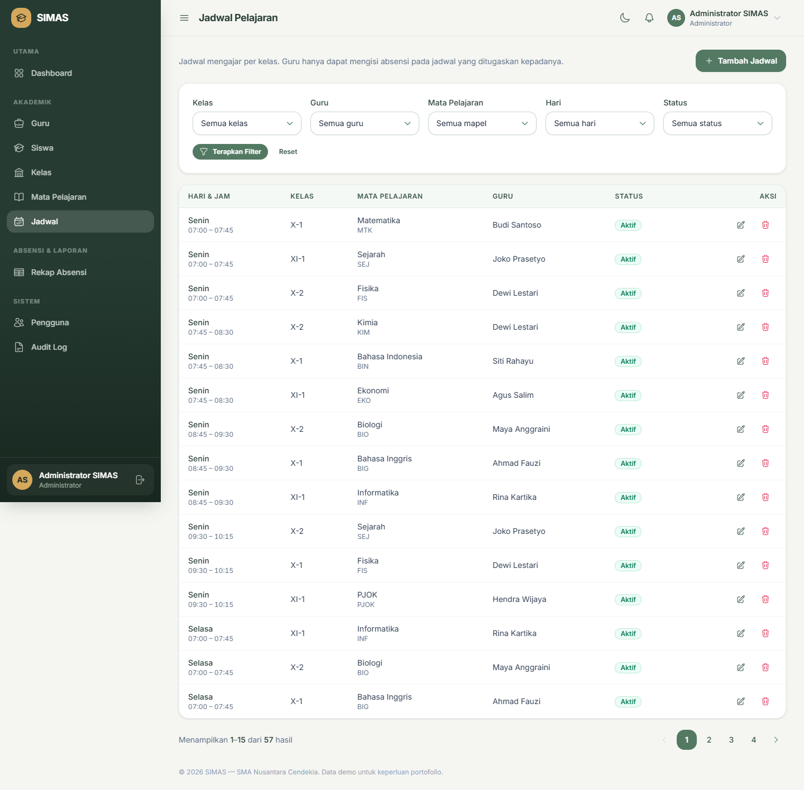 |

### Portal guru

| Dashboard | Form absensi massal |
| --- | --- |
| 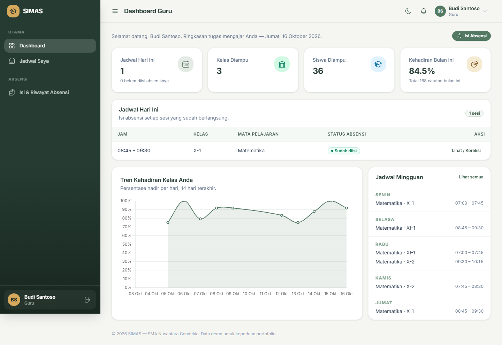 | 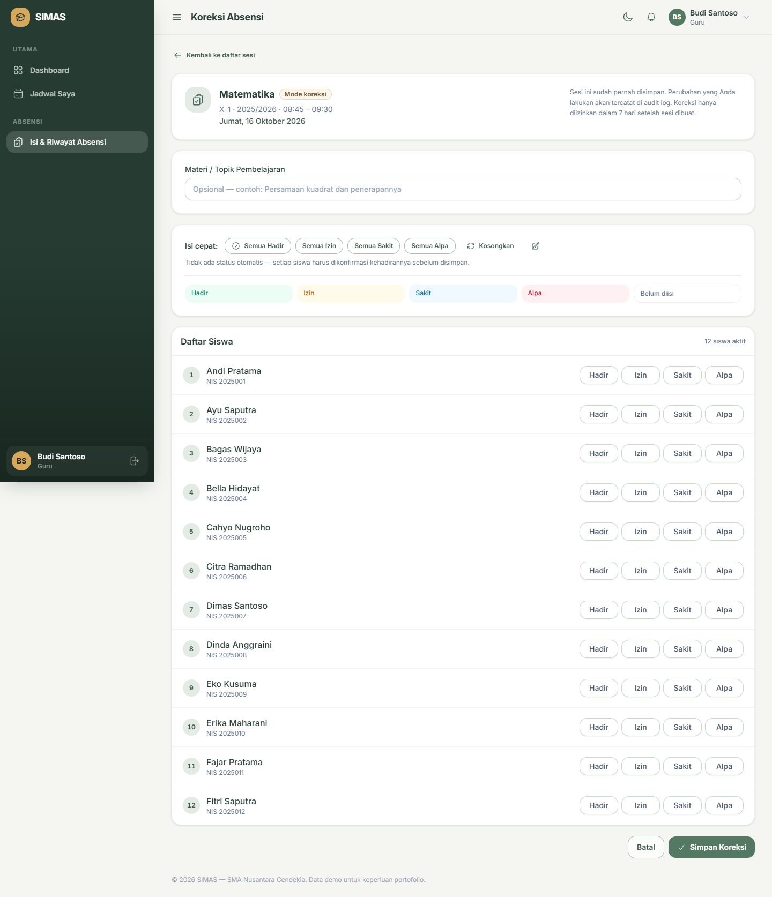 |

### Portal siswa

| Dashboard | Riwayat absensi |
| --- | --- |
| 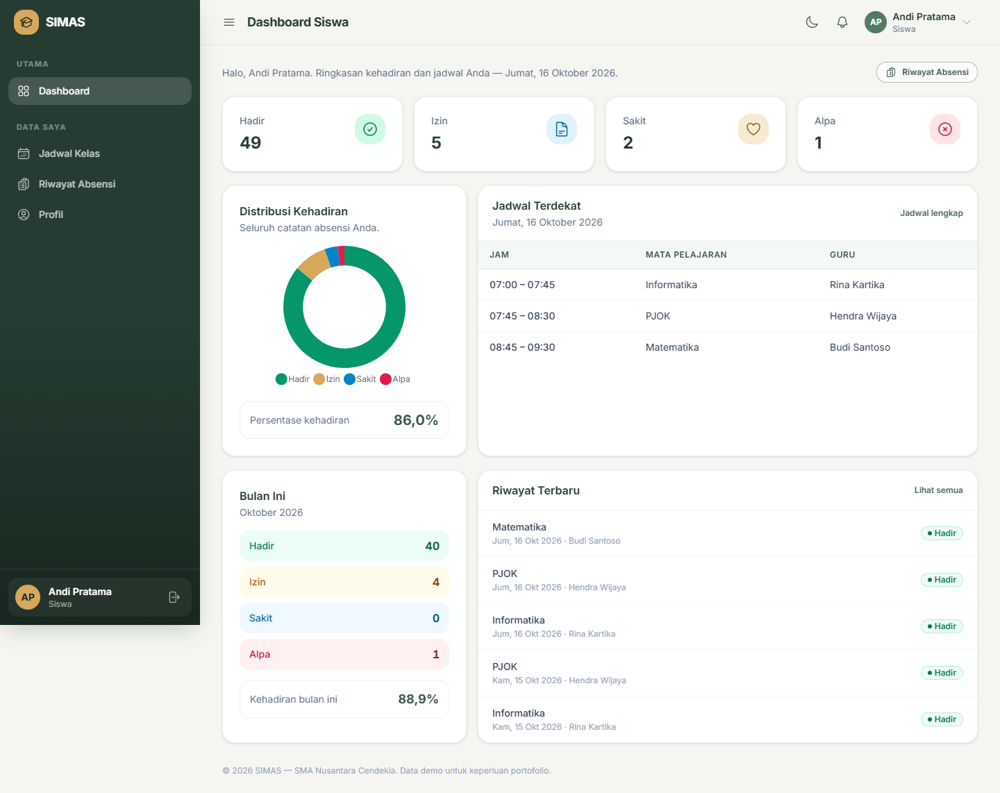 | 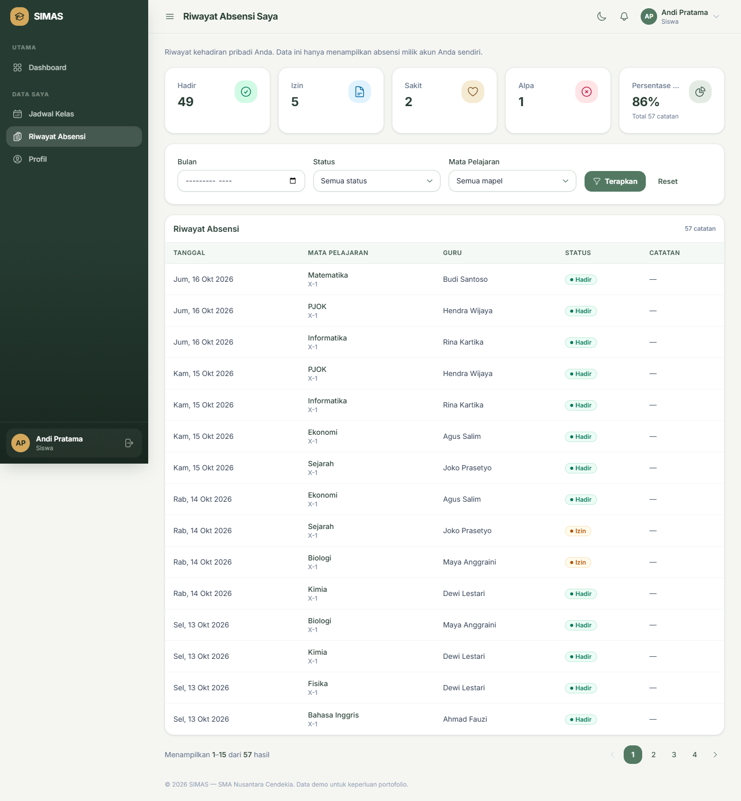 |

### Mode gelap & tampilan ponsel

| Dashboard (gelap) | Form absensi (ponsel) |
| --- | --- |
| 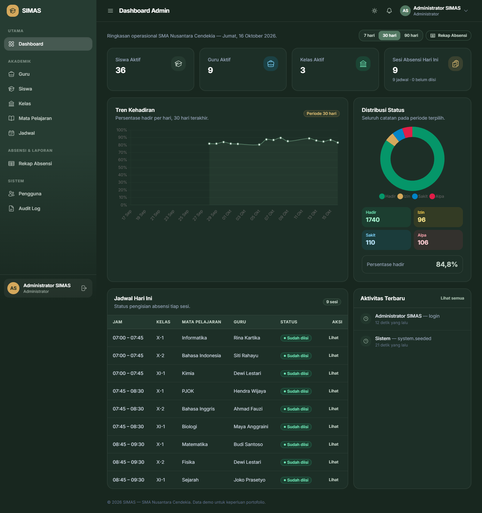 | 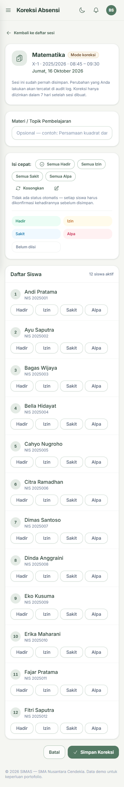 |

---

## Peran Pengguna

| Peran | Akses Utama |
| --- | --- |
| **Admin** | Seluruh data master, rekap absensi, ekspor CSV, audit log |
| **Guru** | Jadwal mengajar sendiri, mengisi & mengoreksi absensi |
| **Siswa** | Jadwal kelas, riwayat absensi sendiri, profil |

Setiap peran diarahkan ke dashboard masing-masing setelah login
(`/admin/dashboard`, `/guru/dashboard`, `/siswa/dashboard`).

---

## Persyaratan Sistem

| Komponen | Versi yang digunakan |
| --- | --- |
| PHP | **8.1+** (dikembangkan pada 8.1.10) |
| Composer | 2.x |
| Node.js | 18+ (dikembangkan pada Node 20) |
| MySQL / MariaDB | MySQL 8 atau MariaDB 10.4+ |
| Ekstensi PHP | `pdo_mysql`, `mbstring`, `openssl`, `fileinfo`, `json` |

> **Catatan versi:** PHP 8.1 membatasi Laravel pada versi 10.x. Jangan
> meng-upgrade dependensi Laravel tanpa menaikkan versi PHP terlebih dahulu.

---

## Instalasi dari Awal

### 1. Clone dan pasang dependensi

```bash
git clone <url-repository> simas
cd simas

composer install
npm install
```

### 2. Siapkan file environment

```bash
cp .env.example .env   # Windows: copy .env.example .env
php artisan key:generate
```

Sesuaikan koneksi database pada `.env`:

```env
DB_CONNECTION=mysql
DB_HOST=127.0.0.1
DB_PORT=3306
DB_DATABASE=simas
DB_USERNAME=root
DB_PASSWORD=
```

### 3. Buat database

```sql
CREATE DATABASE simas CHARACTER SET utf8mb4 COLLATE utf8mb4_unicode_ci;
```

### 4. Migrasi dan isi data demo

```bash
php artisan migrate:fresh --seed
```

Seeder `DemoSchoolSeeder` bersifat **deterministik** (menggunakan seed acak
tetap), sehingga jumlah dan isi data selalu sama setiap kali dijalankan.
Perintah ini akan menghasilkan sekitar:

- 46 pengguna (1 admin, 9 guru, 36 siswa)
- 3 kelas, 10 mata pelajaran, 57 jadwal
- 171 sesi absensi dan 2.052 catatan absensi pada 15 hari sekolah terakhir

### 5. Build aset frontend

```bash
npm run build
```

Untuk pengembangan dengan hot reload:

```bash
npm run dev
```

### 6. Jalankan aplikasi

```bash
php artisan serve
```

Buka <http://localhost:8000>.

---

## Akun Demo

Semua akun demo menggunakan kata sandi: **`password`**

| Peran | Email | Username |
| --- | --- | --- |
| Admin | `admin@simas.test` | `admin` |
| Guru | `budi.santoso@simas.test` | `budi.santoso` |
| Siswa | `andi.pratama@siswa.simas.test` | `andi.pratama` |

Akun guru dan siswa lain juga dibuat oleh seeder dengan pola email yang sama
(`{nama}@simas.test` untuk guru dan `{nama}@siswa.simas.test` untuk siswa).

---

## Aturan Bisnis Penting

### Anti-duplikasi absensi
- **Satu sesi per jadwal per tanggal** — dijamin oleh *unique constraint*
  `(schedule_id, session_date)` pada tabel `attendance_sessions`.
- **Satu catatan absensi per siswa per sesi** — dijamin oleh *unique constraint*
  `(attendance_session_id, student_id)` pada tabel `attendances`.

Constraint ini berada di level database, sehingga tetap berlaku walaupun ada
permintaan ganda (double submit) atau celah pada validasi aplikasi.

### Validasi pengisian absensi (guru)
- Tanggal sesi harus **sesuai hari jadwal** (mis. jadwal Senin hanya dapat diisi
  untuk tanggal yang jatuh pada hari Senin).
- Tanggal sesi **tidak boleh melewati hari ini** dan **maksimal 90 hari ke belakang**.
- **Semua siswa aktif di kelas wajib memiliki status** sebelum dapat disimpan.
- Status yang valid: `hadir`, `izin`, `sakit`, `alpa`.

### Koreksi absensi
- Guru hanya dapat mengoreksi sesi absensi dalam **7 hari terakhir**
  (`SIMAS_ATTENDANCE_EDIT_WINDOW_DAYS`). Setiap koreksi tercatat di audit log.
- Admin bersifat **read-only** pada rekap absensi. Koreksi hanya dapat
  dilakukan oleh guru pemilik jadwal.

### Integritas data
- Penghapusan siswa/guru/kelas/mapel **tidak menghapus riwayat absensi**
  (`restrictOnDelete`), melainkan ditolak dan disarankan untuk menonaktifkan.
- Persentase kehadiran = `hadir / total catatan × 100`. Bila belum ada catatan,
  antarmuka menampilkan **"Belum ada data"** (bukan 0%).

---

## Menjalankan Test

```bash
php artisan test
```

Test berjalan pada **SQLite in-memory** (lihat `phpunit.xml`), sehingga
**tidak menyentuh database MySQL** milik pengembangan.

Cakupan pengujian (60 test):

| Berkas | Fokus |
| --- | --- |
| `tests/Feature/Auth/AuthenticationTest.php` | Login email/username, akun nonaktif, logout, redirect per role, rate limit |
| `tests/Feature/Auth/AuthorizationTest.php` | Akses lintas role (403), tamu diarahkan ke login, siswa tidak dapat mengirim absensi |
| `tests/Feature/Admin/MasterDataTest.php` | CRUD data master, validasi unique, bentrok jadwal, perlindungan admin utama |
| `tests/Feature/Admin/ReportTest.php` | Dashboard, filter rekap, ekspor CSV, audit log, statistik & tren |
| `tests/Feature/Guru/AttendanceTest.php` | Isi absensi, kepemilikan jadwal, wajib semua status, anti-duplikasi, jendela koreksi |
| `tests/Feature/Siswa/StudentPortalTest.php` | Isolasi data siswa, filter riwayat, ringkasan & persentase |
| `tests/Feature/Performance/QueryCountTest.php` | Deteksi N+1 pada dashboard, rekap, detail sesi, dan riwayat siswa |

Untuk menjalankan sebagian test:

```bash
php artisan test --filter=AttendanceTest
```

---

## Struktur Proyek

```
app/
├── Http/
│   ├── Controllers/
│   │   ├── Admin/      # Data master, rekap absensi, audit log
│   │   ├── Auth/       # Login & logout
│   │   ├── Guru/       # Dashboard, jadwal, absensi
│   │   └── Siswa/      # Dashboard, profil, jadwal, riwayat
│   ├── Middleware/     # role, EnsureAccountIsActive
│   └── Requests/       # Validasi (Admin & Guru)
├── Models/             # User, Teacher, Student, SchoolClass, Subject,
│                       # Schedule, AttendanceSession, Attendance, AuditLog
├── Policies/           # SchedulePolicy, AttendanceSessionPolicy
├── Services/           # AuditLogger, ScheduleConflictChecker, AttendanceStats
└── Support/            # Icons (heroicons), helpers

database/
├── migrations/         # Skema sesuai ERD
├── factories/          # Factory untuk seluruh model
└── seeders/            # AdminUserSeeder, DemoSchoolSeeder

resources/
├── css/app.css         # Design system (Tailwind layers)
├── js/app.js           # Alpine stores/components, Chart.js defaults
└── views/
    ├── components/     # layout, stat-card, status-badge, empty-state, icon
    ├── admin/ guru/ siswa/
    ├── auth/ errors/
    └── vendor/pagination/

docs/
├── README.md                        # Indeks dokumentasi
├── SIMAS_Blueprint_PRD_ERD_SRS.md   # Blueprint produk, ERD, dan SRS
├── IMPLEMENTATION-STATUS.md         # Status per tahap & keputusan teknis
└── screenshots/                     # Tangkapan layar portofolio

scripts/
├── generate-icons.cjs               # Generator ikon Heroicons → app/Support/Icons.php
└── capture-screenshots.cjs          # Generator tangkapan layar (butuh puppeteer-core)

tests/Feature/
├── Auth/ Admin/ Guru/ Siswa/        # Test fungsional & keamanan
└── Performance/                     # Deteksi N+1
```

---

## Troubleshooting

**`npm run build` gagal dengan pesan terkait ESM / `require`**
Pastikan `package.json` **tidak** memiliki `"type": "module"`. Konfigurasi
Vite/Tailwind/PostCSS pada proyek ini menggunakan format CommonJS.

**Aset CSS/JS tidak berubah setelah edit**
Jalankan `npm run build` (produksi) atau `npm run dev` (pengembangan), lalu
lakukan hard refresh pada browser.

**Halaman error menampilkan tumpukan error saat demo**
Setel `APP_DEBUG=false` pada `.env` agar halaman error kustom (403/404/500)
yang tampil.

**Test gagal dengan error `FIELD` / fungsi SQL tidak dikenal**
Pastikan konfigurasi test memakai SQLite in-memory (`phpunit.xml`). Seluruh
query pada aplikasi dibuat portabel untuk MySQL maupun SQLite.

**Lupa kata sandi akun demo**
Jalankan ulang `php artisan migrate:fresh --seed`. Semua kata sandi akun demo
adalah `password`.

---

## Keamanan & Privasi

- Berkas `.env` **tidak** di-commit (lihat `.gitignore`).
- Tidak ada kredensial, token, atau API key di dalam kode maupun README.
- Kata sandi disimpan dengan *hash* bcrypt.
- Seluruh aksi tulis dilindungi CSRF token.
- Otorisasi ditegakkan di server melalui middleware role dan policy;
  menyembunyikan elemen UI bukan mekanisme keamanan.
- Seluruh data pada repositori ini adalah data demo yang di-generate.

---

## Lisensi

Dirilis di bawah [MIT License](https://opensource.org/licenses/MIT).
Kerangka Laravel sendiri juga dilisensikan MIT.
